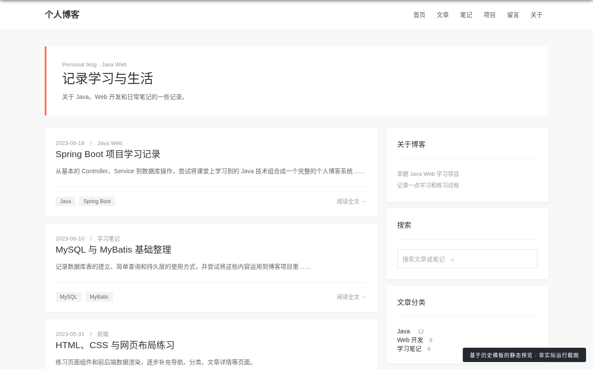
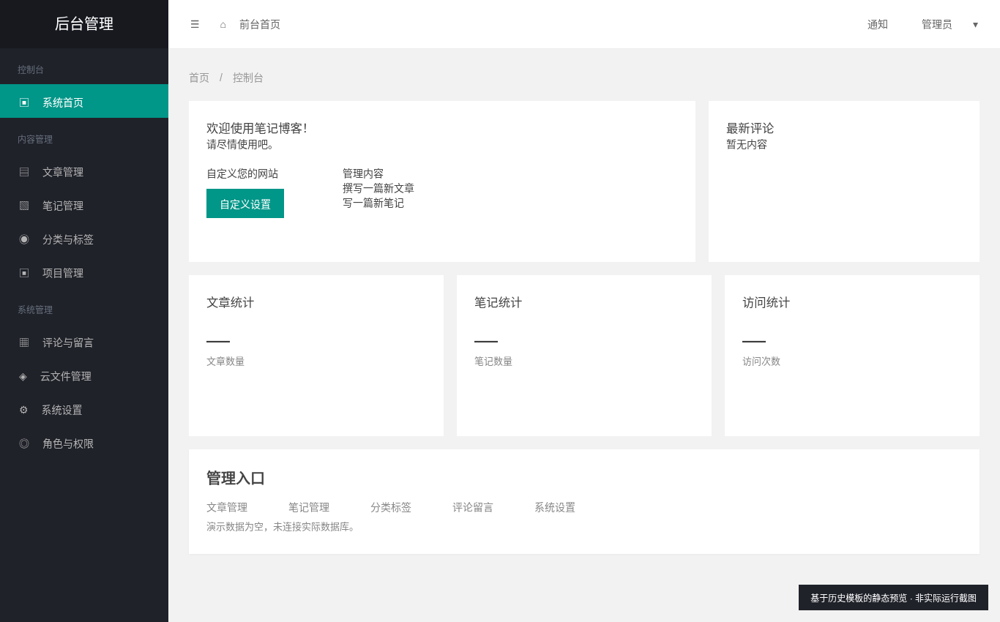

# 个人博客系统 / Personal Blog System

## 中文

这是我在大一下学期，刚学完 Java 相关技术栈之后，为了练习 Java Web 开发而完成的一个项目。2026 年 10 月 21 日，我从电脑磁盘深处重新翻出了这个已经放了很久的项目。 然后脑子一抽把它整理出来上传到 GitHub，就当是给自己的学习经历存个档。我将这次上传作为仓库的第一个版本 v1.0.0。后续还会继续升级换代。

## English

This is a project I completed in the second semester of my freshman year, shortly after learning Java and related technologies, to practice Java Web development. On October 21, 2026, I dug it out from the depths of my computer after leaving it untouched for a long time. On a whim, I tidied it up and uploaded it to GitHub as a record of my learning journey. I made this upload the repository's first version, v1.0.0. I'll continue to update it in future versions.

## 页面预览 / Page Previews

以下是根据旧版页面模板制作的静态预览，**不是实际运行截图**。  
The following are static previews based on the original page templates, **not screenshots of the running application**.

**博客首页 / Blog Homepage**

**管理后台 / Admin Panel**

---

基于 [NoteBlogV4](https://github.com/miyakowork/noteblogv4) 学习与修改，遵循其 Apache License 2.0。  
Based on [NoteBlogV4](https://github.com/miyakowork/noteblogv4), with modifications for learning purposes. Original code licensed under Apache License 2.0; see [LICENSE](LICENSE).
